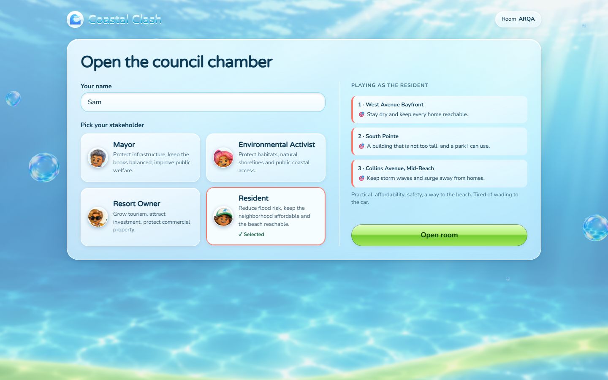

# Coastal Clash

**Four stakeholders. Three real planning fights. One shoreline.**

What if the next argument about your city's future happened around a game table instead of at a town hall?

Coastal Clash is a multiplayer strategy game about real coastal planning decisions in Miami Beach. Play as the Mayor, Resident, Environmental Activist, or Resort Owner. Propose a project, negotiate a change, and vote on the plan that actually gets built. Every match leaves a record of **what people supported, what they opposed, and the conditions that changed their minds**.

Built for **HackNC 2026**, with a Frutiger Aero + Liquid Glass interface: ocean scenery, small floating bubbles, glossy green buttons, glass panels, and animated 3D characters.



[Quick start](#quick-start) · [How to play](#how-to-play) · [Civic Atlas](#what-stays-after-the-match) · [Architecture](#how-it-is-built) · [Implementation status](#implementation-status)

## Inspiration

People spend whole evenings making decisions for imaginary cities. Games like GeoGuessr make exploring unfamiliar places fun. We wanted to bring some of that energy to real decisions about a neighborhood's future.

Surveys, public meetings, and participatory budgeting are valuable. Our question concerns what happens before someone votes yes or no. A resident might support raising a flood-prone road **only if** the city guarantees access to their front door. A business owner might support a different design, contribute to a compromise, or want the project stopped. That “only if” is information worth keeping.

Miami Beach offers concrete conflicts to explore. The [West Avenue Neighborhood Improvements project](https://www.miamibeachfl.gov/projects/west-avenue-neighborhood-improvements-project-phase-ii/) combines flood protection, raised roads, drainage, utilities, and harmonization: connecting raised public streets to existing private properties. It is a real design problem involving safety, access, cost, and competing priorities.

Coastal Clash turns those tensions into a game inspired by the immediacy of Clash Royale. The goal is to surface questions and conditions that deserve further discussion in formal consultation.

## How to play

Host a room and share its code or QR. Up to four people join, one stakeholder each; empty seats are filled by bots when the host starts. The game board is designed for laptops and desktops. The landing page, stakeholder selection, and lobby also adapt to tablet and mobile screens.

| Stakeholder | What is at stake |
| --- | --- |
| **Mayor** | Fix the city's problem, preserve reserves, and keep public access working. Chooses the proposal, but needs other players' votes. |
| **Resident** | Safety, access to home, and the neighborhood left after construction. |
| **Environmental Activist** | Habitat, public space, natural shorelines, and careful development. |
| **Resort Owner** | Viable businesses, visitors, investment, and property protection. |

The map contains South Pointe, West Avenue, Collins/Mid-Beach, and North Beach Oceanside. The current **Planning Edition** plays three authored, source-linked scenarios in a fixed sequence:

| Round | Place and issue | Project choices |
| --- | --- | --- |
| 1 | **West Avenue — flood infrastructure** | Raise roads, improve drainage, or elevate properties. |
| 2 | **South Pointe — land use** | A tower and park, a shorter tower with a smaller park, or a city-funded park. |
| 3 | **Collins/Mid-Beach — shoreline protection** | Add sand, build groins and breakwaters, or restore dunes. |

These cards are simplified options authored for the game. They do not imply that the city put exactly three choices on a ballot. Costs use hypothetical game budget units.

### 1. Play a Card

Read the real issue, its sources, your character's goal, and three project cards. Each card explains its benefit, trade-off, and cost. Everyone privately chooses a project; the cards are then revealed, and the Mayor puts one forward.

### 2. Make a Deal

Support or oppose the proposal, or request an amendment from the scenario's short list. The proposal's sponsor decides whether to accept the change. An amendment changes the actual plan, its cost, or its conditions; it is saved in the match record.

For example, a Resident can ask for a **Property Access Guarantee** before backing raised roads. Then everyone votes. **Three of four votes** are needed to approve a proposal.

### 3. See What Happens

The server applies the rules and gives a verdict:

- **Approved:** the plan passes, fits the budget, and meets its constraints.
- **Rejected:** the proposal does not receive enough votes, or none goes forward.
- **Delayed:** it passes the vote but lacks a required condition, such as safe property access.
- **Unfunded:** its cost exceeds the round budget.

A plan that cannot proceed leaves the status quo. Blocking a harmful or unaffordable project can advance one role's goals while frustrating another's.

### Every point has a reason

Up to **6 points per round**, **18 per match**:

| Score | Points | What earns them |
| --- | --- | --- |
| Goal | 0–3 | The outcome satisfies your role's explicit objectives. |
| Deal | 0–2 | An accepted amendment answers your concern; its author can earn 2, and the sponsor who brokers it can earn 1, if the plan succeeds. |
| City | 0–1 | A shared point for an approved plan within budget and meeting the scenario's constraints. |

The Mayor has a critical objective and can earn zero if the problem is not addressed. Reserve requirements are separate from the shared City point. Rejected, delayed, or unfunded projects are scored as the status quo, including objectives that reward stopping a project. These scores are game design conventions, with explanations on screen.

After round three, **Your Miami Beach Plan** shows what passed, what failed, the negotiated changes, votes, budget, and sources. A storm tests the plan, and the simulator compares it with alternatives.

## What stays after the match

A vote records which option won. Coastal Clash also records the path to that vote:

- The real issue, sources, and map location.
- Each player's project choice and stance.
- Requested amendments, their effects, and whether they were accepted.
- Votes, verdicts, the adopted plan or status quo, and scores with reasons.
- Separate, voluntary personal answers given outside the assigned role.

**Role-play is not public opinion.** Winning as the Resort Owner does not mean a person wants hotels on every beach. In-role decisions, personal answers, bots, and demo/community session labels remain distinct.

The **Civic Atlas**, at `/atlas`, explores these records in four views:

| View | What it shows |
| --- | --- |
| Real issues | Source-linked situations, projects, and constraints. |
| Human decisions | Picks, support, opposition, requested changes, votes, and separate personal answers. |
| Plan explorer | Plans people built compared with feasible alternatives. |
| Planning insights | Patterns with sample sizes and the records behind them. |

A pattern such as “support for road elevation increased after an access guarantee” is a lead for further consultation. It does not establish what Miami Beach residents think: who played, their assigned roles, and the choices they saw all matter.

## A small, transparent simulator

The simulator evaluates **1,400 feasible plans**, including amended variants, under three futures: ordinary high tide, minor flooding with heavy rain, and major flooding. NOAA Virginia Key tide levels and FEMA flood-zone shares ground the comparison.

Project effects are explicitly labeled assumptions. The output ranks plans by flood exposure, public access, and cost; it is **not a flood forecast or an engineering assessment**. Assumptions and their sources live in [`sim-assumptions.ts`](shared/src/game/plan/sim-assumptions.ts), and [`sim.ts`](shared/src/game/plan/sim.ts) contains the model. A test checks that the committed simulator cache matches the rules.

## How it is built

The project builds on our earlier work: **Pocket Rivals** contributed the real-time room and synchronized-play pattern, while **Mayday Mayor** informed civic records and contribution incentives.

```text
app/       React + Vite + TypeScript, MapLibre, three.js, motion, Tailwind
shared/    Deterministic rules, scenarios, scoring, simulator, records, Atlas aggregation
server/    Fastify + WebSockets, authoritative rooms, narration, voices, persistence
pipeline/  GIS extraction, civic research corpus, Snowflake loading, Gemini casting
docs/      Rules, data provenance, setup, handoffs, and verification notes
```

The server owns proposals, amendments, voting, budgets, and scoring. Shared TypeScript rules determine outcomes. **Gemini can explain and narrate; it cannot decide votes, verdicts, or points.** Narration is checked against supplied facts, and lines with unsupported numbers fall back to templates.

### Civic research and scenario casting

The research workflow separates agenda scouting, project tracking, geographic matching, documented concerns, verification, and human review. It organizes planning information scattered across project pages, public records, GIS layers, and local reporting.

This repository includes the [research corpus](pipeline/research/miami-beach-civic-corpus.json), [Snowflake loader](pipeline/snowflake-load.ts), [Gemini casting script](pipeline/cast-stories.ts), and [cast validation](shared/src/game/story.ts). Facts, documented positions, places, source links, and verification notes travel with each story. The autonomous scout orchestration described in the broader project is not packaged as a runnable service here.

The Snowflake story feed admits reviewed, approved, validly cast stories. The current Planning Edition uses its three committed scenarios, checked against the local corpus by tests, rather than generating new scenarios at match start. Gemini supplies the news anchor and character dialogue from those facts and the engine's decisions.

### Integrations and hackathon tracks

| Track / technology | Contribution |
| --- | --- |
| **General** | A complete three-round multiplayer planning game. |
| **Frutiger Aero Tech** | Shared aqua glass, glossy controls, ocean scenery, bubbles, and 3D characters over real geographic data. |
| **Community** | A format for negotiating a neighborhood's future and retaining conditional feedback. |
| **Gemini API** | Offline scenario casting, grounded narration, character dialogue, and legacy card art/scenario services. |
| **ElevenLabs** | Distinct voices for the news anchor and stakeholders, with queued speech and captions. |
| **Snowflake API** | Source-linked research storage, approval metadata, and the SQL API story feed. |
| **Solana** | Legacy-match fingerprints, summary memos, Merkle batch anchors, and public verification on devnet; contribution incentives are future work in this tree. |
| **Tiger Data** | Match records and decision rows with places and timestamps, plus gameplay events and summaries. Atlas aggregates saved records. |
| **Ig Turing** | A party game with talking characters that also captures material for planning research. |

### Public records and contribution incentives

The implemented Solana service hashes a canonical **legacy** decision record with SHA-256, writes a short outcome memo, and anchors batches with Merkle proofs. `/verify/:matchId` recomputes the covered fingerprint and checks its proof. Names and voluntary personal answers are excluded. A proof detects changes to the covered record; it does not establish that participants are representative or that the underlying claims are true.

**Planning Edition records are not yet connected to this ledger.** They use a newer record shape, while the current civic service requires the legacy `final` result. Solana is outside the live Planning Edition demo and uses a simulated authority on devnet.

The incentive design explored in Mayday Mayor is a non-transferable contribution card: a city or planning partner could recognize useful contributions and honor cards with off-chain perks. Minting these cards is **not implemented in this repository** and is not a live city program.

## Quick start

Use **Bun 1.4+** and **Node 22.12+** (Node 20.19+ is also supported). Bun manages the workspaces; Node runs the test and server tooling.

```bash
git clone https://github.com/RudrakshNanavaty/hacknc-26.git
cd hacknc-26
bun install
bun run dev
```

Open **http://localhost:5173**. The API and WebSocket server use port **8787**. Host a match, choose your role, and start with friends or bots. Other laptops can use the host's LAN address when the network allows it.

All API keys are optional. To enable integrations, copy `.env.example` to `.env` and fill in the relevant values. On PowerShell, use `Copy-Item .env.example .env`; on macOS/Linux, use `cp .env.example .env`. Keep `.env` out of version control.

| Configuration | Purpose and fallback |
| --- | --- |
| `GEMINI_API_KEY` | AI narration and related services; otherwise template text and placeholder art. |
| `ELEVENLABS_API_KEY` | Spoken headlines and character lines; otherwise captions without generated speech. |
| `DATABASE_URL` | Tiger Data/PostgreSQL; otherwise records persist in `server/.cache/matches.json`. |
| `SNOWFLAKE_ACCOUNT`, `SNOWFLAKE_TOKEN`, `SNOWFLAKE_WAREHOUSE`, `SNOWFLAKE_ROLE` | Research feed; the Planning Edition's committed scenarios remain playable without it. |
| `SOLANA_PAYER_SECRET_KEY`, `SOLANA_RPC_URL` | Optional legacy devnet ledger; without a funded authority, chain writes are unavailable. |
| `PUBLIC_URL` | Public base URL for room QR links; otherwise the host's LAN address is used locally. |

Optional integrations fail independently so a missing key does not block the game. See [the developer guide](docs/contributing.md) for configuration and troubleshooting.

### Commands

```bash
bun run dev          # Vite app and Fastify server
bun run typecheck    # shared, app, and server workspaces
bun run test         # rules, rooms, records, integrations, and app helpers
bun run build        # production client in app/dist
bun run start        # serves the built client, API, and WebSockets on :8787
```

[`Dockerfile`](Dockerfile) and [`render.yaml`](render.yaml) describe a single-service deployment. Supply secrets through the hosting environment. If using local-file persistence in production, provide persistent storage; ephemeral hosts can discard their files.

## Implementation status

The default game is **Planning Edition**, rules `coastal-clash-rules/planning-1.0.0`. The earlier card game remains available through the room protocol for legacy matches and replay.

- Three-round play, bots, explicit scoring, amendment negotiation, the simulator, and Planning Edition Atlas are implemented.
- **215 automated tests across 20 files** pass, along with workspace typechecking and the production build, as of October 11, 2026.
- Landing, selection, and lobby were browser-checked at **1440×900, 1280×720, 768×1024, and 390×844**, including a second client joining, role switching, bot controls, and game start. The game board remains desktop-oriented.
- Live vendor availability depends on credentials, quotas, and network access. Passing integration tests does not certify live service availability.
- Planning Edition Solana anchoring, contribution-card minting, and a deployable autonomous research swarm remain outside this build's completed features.

Details: [Planning Edition](docs/planning-edition.md), [UI verification](docs/progress/ui-polish.md), and [current handoff](docs/progress/simple-clash.md).

## Challenges and lessons

**Negotiation has to change the plan.** Early versions had influence, combos, and many city meters. We simplified the Planning Edition around concrete changes that affect cost, access, design, and the recorded outcome.

**Choosing the agenda should not guarantee winning.** The Mayor has explicit objectives and can fail them. Every role can reach both zero and three goal points in each scenario, checked by tests.

**Documents need context.** The research corpus retains source disagreements, including different reported costs and volumes for beach renourishment. Sources, inferred role objectives, and illustrative options remain distinguishable.

**Simulation needs visible assumptions.** Real flood zones do not establish a project's effectiveness. The model's assumed effects are listed openly.

The most useful moment turned out to be small: “I could support that, but only if.” That is where a disagreement becomes a design problem people can negotiate.

## What's next

Run a participatory planning workshop with residents and planning researchers. Check whether players understand the projects, have domain experts review simulator assumptions, and test whether the format surfaces conditions that a questionnaire misses. Extend the public ledger to Planning Edition records and develop contribution incentives with a real partner. Then take the research workflow to other cities and conflicts in housing, transportation, public space, and utilities.

## Sources and further reading

Scenario sources are clickable in the game and recorded in the [civic corpus](pipeline/research/miami-beach-civic-corpus.json). Start with:

- [City of Miami Beach: West Avenue Neighborhood Improvements](https://www.miamibeachfl.gov/projects/west-avenue-neighborhood-improvements-project-phase-ii/).
- [Miami Today: 44-story limit on the Alton Road site](https://www.miamitodaynews.com/breaking/beach-commission-hear-44-story-limit-alton-road-site/).
- [Miami-Dade County: Beach Renourishment](https://miamidade.gov/environment/beach-renourishment.asp).
- [Miami Today: New ways to retain beach sand](https://www.miamitodaynews.com/?p=76028) and [Dredging Today: Miami Beach project](https://dredgingtoday.com/?p=82517); the corpus documents differing cost and volume figures.
- [NOAA CO-OPS: Virginia Key, station 8723214](https://tidesandcurrents.noaa.gov/stationhome.html?id=8723214).
- [Miami Beach zoning GIS](https://gis.miamibeachfl.gov/public/rest/services/gc/gc_Zoning/MapServer/0) and [Miami-Dade FEMA flood-zone GIS](https://gisweb.miamidade.gov/ArcGIS/rest/services/EnerGov/MD_LandMgtViewer/MapServer/63).

For development, read [`AGENTS.md`](AGENTS.md), the [Planning Edition rules](docs/planning-edition.md), and the [contributing guide](docs/contributing.md). The [earlier design and architecture](docs/coastal-clash.md) documents the legacy game and its integrations.

People already love making decisions about imaginary cities. We want to find out whether that same energy can help real ones have better conversations.
